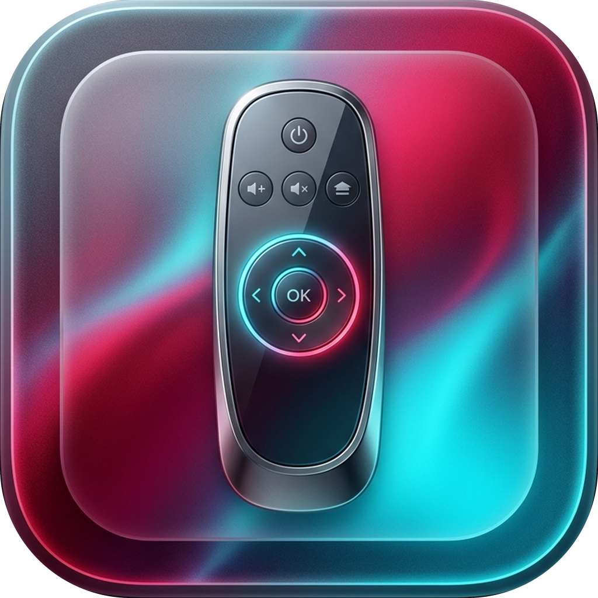

<p align="center">
  
</p>

<h1 align="center">LiquidRemote</h1>

<p align="center">
  <b>A native, ultra-modern macOS menu bar universal remote for Smart TVs and streaming devices.</b><br>
  Crafted with SwiftUI & AppKit • Liquid Glass Translucency • Universal Wake-on-LAN • Zero Third-Party Dependencies
</p>

<p align="center">
  
  
  
  
  
  
</p>

---

## ✨ Overview

**LiquidRemote** brings tactile, responsive, and beautiful TV control directly to your macOS menu bar. Designed from the ground up for macOS Sonoma and Sequoia, it pairs a native **Liquid Glass** aesthetic with multi-protocol Smart TV communication, intelligent network discovery, and universal Wake-on-LAN.

Whether you're adjusting volume with your trackpad, launching your favorite streaming app, waking a sleeping TV over Wi-Fi, or switching between multiple displays across rooms, LiquidRemote offers a seamless desktop experience without ever reaching for a physical remote.

---

## 📡 Supported Smart TV Operating Systems & Protocols

LiquidRemote natively implements the major Smart TV network protocols, powering **30+ TV and streaming hardware brands**:

| Platform / Protocol | Default Port | Supported Brands & Hardware | Capabilities | Status |
|---|:---:|---|---|:---:|
| **Roku OS (ECP HTTP)** | `8060` | Roku Players, **TCL**, **Hisense**, **Sharp**, **Philips**, **Insignia**, **JVC**, **Hitachi**, **Toshiba**, **Sceptre**, **onn.** | D-Pad, OK, Back, Home, Media, Volume, Mute, Power, Sleep, Star/Info, App Launch, Now Playing Artwork | ✅ **Full Support** |
| **Samsung Tizen OS (WebSocket)** | `8002` / `8001` | All **Samsung** Smart TVs (QLED, Neo QLED, OLED, Frame, Crystal UHD 2016–2026) | On-screen pairing prompt, persistent token, D-Pad, Home, Back, Volume, Mute, Power, Sleep, Info, Tizen App Launch | ✅ **Full Support** |
| **LG webOS (SSAP WebSocket)** | `3001` / `3000` | All **LG** Smart TVs (OLED, QNED, NanoCell, UHD webOS 3.0+) | On-screen pairing prompt, pointer/button socket, D-Pad, Volume, Absolute Volume Slider, App Launch, Power Off | ✅ **Full Support** |
| **Sony BRAVIA (IRCC-IP & REST)** | `80` | **Sony** BRAVIA XR, OLED, Mini LED, X90L/A80L/A95L & Android/Google TV models | Pre-Shared Key (`X-Auth-PSK`) auth, IRCC SOAP commands, D-Pad, Home, Back, Direct Volume Slider, App Launch | ✅ **Full Support** |
| **Vizio SmartCast (HTTPS REST)** | `7345` | All **Vizio** SmartCast 4K UHD, Quantum, and OLED TVs | HTTPS key command codesets, D-Pad, OK, Back, Home, Info, Volume, Mute, Power, Sleep, Media Playback | ✅ **Full Support** |
| **Philips JointSpace (REST)** | `1925` | **Philips** Smart TVs, Ambilight TVs, Saphi & Android models | JointSpace v6/v1 key injection, D-Pad, Confirm, Back, Home, Options, Standby, Direct Audio Volume | ✅ **Full Support** |
| **Google TV / Android TV** | `8008` / `6466` | **Chromecast**, **NVIDIA Shield**, **Xiaomi Mi Box**, **onn.**, **TiVo Stream**, **MECOOL**, **Formuler**, **Nokia** | DIAL REST instant App Launching (`:8008`), Bonjour discovery, Wake-on-LAN, Remote v2 key mappings | ⚡ **DIAL + WoL** |
| **Amazon Fire TV** | `8008` / `5555` | **Fire TV Stick 4K Max**, **Fire TV Cube**, **Fire TV Omni**, **Insignia/Toshiba Fire TV** | DIAL REST instant App Launching (`:8008`), Wake-on-LAN | ⚡ **DIAL + WoL** |
| **UPnP / DLNA MediaRenderer** | `80` / `var` | Universal Smart TVs, Network Soundbars & AV Receivers | SOAP `RenderingControl` absolute volume slider, Volume Up/Down, Mute toggle | ✅ **Full Support** |
| **Universal Wake-on-LAN** | `UDP 9 / 7` | **All 30 Supported TV & Streaming Brands** | 102-byte Magic Packet broadcast + direct subnet ARP MAC address discovery | ✅ **Full Support** |

---

## 🚀 Key Features

### 🪟 Dynamic Liquid Glass UI
- **Real-Time Translucency Engine**: Adjust glass frostedness from **15% (frosted dark)** to **100% (crystal clear liquid glass)** to match your desktop wallpaper and macOS appearance.
- **18 Vibrant Accent Palettes**:
  - *Warm & Crimson*: Roku Crimson, Vivid Ruby, Sunset Orange, Amber Glow, Electric Gold
  - *Neon & Electric*: Neon Lime, Emerald Mint, Electric Teal, Cyber Cyan
  - *Cool & Vivid*: Sky Blue, Royal Indigo, Ultraviolet, Hot Magenta, Coral Pink, Rose Gold
  - *Modern Neutrals*: Platinum Silver, Stealth Graphite, Dark Obsidian
- **Interactive Micro-Interactions**: Fluid glass hover states, spring-physics scaling, and macOS system haptic feedback on every press.

### 📺 30 Authentic Brand Logos & Menu Bar Icons
- Authentic, pixel-perfect logos and customized 22×22 Retina menu bar icons for:
  - **Top 20 TV Brands**: Samsung, LG, Sony, TCL, Hisense, Sharp, Vizio, Roku TV, Philips, Panasonic, Toshiba, Insignia, JVC, Pioneer, Sceptre, Xiaomi, OnePlus, Skyworth, Haier, Hitachi.
  - **Top 10 Android & Streaming Devices**: Apple TV, Google TV, Amazon Fire TV, NVIDIA Shield, Xiaomi Mi Box, onn. Google TV, TiVo Stream 4K, MECOOL, Formuler, Nokia Streaming Box.
- **Smart Brand Detection**: Multi-protocol SSDP and subnet probing automatically identifies your TV vendor and applies its official brand logo in both the remote header and macOS menu bar.

### 🔊 Bespoke Liquid Glass Volume Capsule
- **Clean Tactile Level Bar**: Smooth glowing accent gradient with a translucent glass thumb handle and `-` / `+` step buttons—free of misleading numerical readouts.
- **Two-Finger Scroll Gestures**: Scroll vertically with two fingers anywhere on the remote panel to adjust TV volume smoothly with haptic clicks.

### 📱 Configurable Quick-Launch App Grid
- **Customizable Layout**: Choose **2, 4, 6, or 8** quick-launch app buttons directly from the remote's `⋯` menu or Settings.
- **16 Supported Streaming Services**:
  - Netflix • YouTube • Disney+ • Prime Video • Hulu • Max • Apple TV • Spotify
  - Paramount+ • Peacock • Plex • Twitch • Tubi • Pluto TV • ESPN • Crunchyroll
- Instant deep-linking and launching via native platform app IDs across Roku, Samsung Tizen, LG webOS, Sony BRAVIA, Fire TV, and Google TV (DIAL).

### 🎮 Comprehensive Remote Controls
- **Precision D-Pad**: Fluid 5-way directional control with optional double-tap-to-select safety guard.
- **Home, Star & Sleep Action Row**:
  - `[ ★ ]` **Star / Info Button**: Opens context options or stream info (`Info` on Roku, `KEY_INFO` on Samsung, `INFO` on LG webOS, `Options` on Sony/Philips).
  - `[ ⌂ Home ]` **Home Button**: Prominently centered.
  - `[ ☾ Sleep ]` **Sleep Mode Button**: Puts TV into low-power standby (`PowerOff` / `KEY_SLEEP` / `Standby`).
- **Dynamic Auto-Resizing Window**: Window frame dynamically expands and contracts to fit active app counts and unwrapped, dismissible alert banners.

### ⌨️ Global Keyboard Hotkeys
Control your TV from anywhere in macOS, even while working in other apps:
- `⌃⌥⌘ ↑` — Volume Up
- `⌃⌥⌘ ↓` — Volume Down
- `⌃⌥⌘ M` — Mute Toggle
- `⌃⌥⌘ Space` — Play / Pause

---

## ⚙️ Quick TV Setup Guide

> [!TIP]
> - **Roku TVs**: Ensure mobile control is enabled under `Settings` → `System` → `Advanced system settings` → `Control by mobile apps` → `Network access` → **Permissive**.
> - **Samsung Tizen TVs**: On first button press, select **Allow** on the popup notification that appears in the top-right corner of your Samsung TV screen.
> - **LG webOS TVs**: Accept the on-screen pairing prompt on first connect. LiquidRemote automatically stores the returned client key.
> - **Sony BRAVIA TVs**: Enable IP Control under `Settings` → `Network & Internet` → `Home network setup` → `IP control` → set `Authentication` to **Normal and Pre-Shared Key** and `Pre-Shared Key` to `0000`.

---

## 🛠️ Building from Source

### Prerequisites
- macOS 14.0 (Sonoma) or macOS 15.0+ (Sequoia)
- Xcode 15+ or Command Line Tools (`xcode-select --install`)
- Swift 5.10+ toolchain

### Quick Build & Run

Clone the repository and run the automated build script:

```bash
git clone https://github.com/doodaddude/LiquidRemote.git
cd LiquidRemote

# Build, package, and sign with Developer ID (or ad-hoc fallback)
./build.sh

# Launch the app
open build/LiquidRemote.app
```

---

## 🗂️ Project Structure

```
LiquidRemote/
├── App/
│   ├── LiquidRemoteApp.swift           # Application entry point & AppDelegate
│   └── RemoteHub.swift                 # Command routing & device state manager
├── Discovery/
│   └── DeviceDiscovery.swift           # Multi-protocol SSDP, subnet ARP & Bonjour scanner
├── Input/
│   └── HotKeyManager.swift             # Carbon global keyboard shortcuts
├── MenuBar/
│   └── MenuBarManager.swift            # NSStatusItem & dynamic auto-resizing NSPanel
├── Models/
│   ├── RemoteModels.swift              # Core data models, app catalog & brand gallery
│   └── DeviceStore.swift               # UserDefaults persistence & WoL MAC resolver
├── Protocols/
│   ├── RemoteController.swift          # Unified controller protocol & factory
│   ├── RokuController.swift            # Roku ECP HTTP protocol client
│   ├── SamsungTizenController.swift    # Samsung Tizen WSS/WS remote & REST client
│   ├── LGWebOSController.swift         # LG webOS SSAP WebSocket client
│   ├── SonyBraviaController.swift      # Sony BRAVIA IRCC-IP SOAP & REST client
│   ├── VizioSmartCastController.swift  # Vizio SmartCast HTTPS REST client
│   ├── PhilipsJointSpaceController.swift # Philips JointSpace v6/v1 REST client
│   ├── FireTVController.swift          # Amazon Fire TV DIAL & keyevent controller
│   ├── AndroidTVController.swift       # Google TV / Android TV DIAL & Remote v2
│   ├── AppleTVController.swift         # Apple TV Companion controller
│   ├── UPnPController.swift            # UPnP/DLNA SOAP RenderingControl client
│   └── WakeOnLAN.swift                 # Universal Wake-on-LAN magic packet engine
├── Resources/                          # 30 brand logos, menu bar icons & AppIcon.icns
├── Views/
│   ├── LiquidRemoteView.swift          # Main liquid glass remote interface
│   ├── SettingsView.swift              # Device management, brand picker & preset apps
│   ├── BrandLogoView.swift             # High-fidelity brand vector/PNG renderer
│   ├── DPadView.swift                  # 5-way directional control pad
│   └── GlassStyle.swift                # Liquid glass shaders, press styles & materials
├── Info.plist                          # Bundle metadata & network entitlement declarations
├── build.sh                            # One-click compilation & code-signing script
├── CHANGELOG.md                        # Version history and release notes
├── LICENSE                             # MIT License
└── README.md
```

---

## 🔒 Security & Code Signing

LiquidRemote is signed with a valid Apple Developer ID:
- **Developer ID Application**: `Dakota Hilchey (2FCUC227QF)`
- **Hardened Runtime**: Enabled (`flags=0x10000(runtime)`)
- **Team Identifier**: `2FCUC227QF`

Verify bundle integrity at any time via:
```bash
codesign -dvvv /Applications/LiquidRemote.app
```

---

## 📄 License

LiquidRemote is licensed under the **[MIT License](LICENSE)**.

Copyright (c) 2026 Dakota Hilchey ([@doodaddude](https://github.com/doodaddude)).
